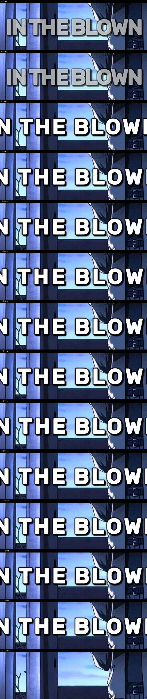

## How to update
- `git pull origin main`
- Shorts rendered before 1.0.1 keep the old caption look (already posted).
  To renew one locally: `rm renders/<id>/clips/*.mp4` then re-run
  `mangacap cut <chapter> --short <id>`.

## 🎞️ Renderer 🎞️
### Added

* Spring caption pop — caption blocks are born clumped (~90% of settled
  letter-gap width), ease out fast, overshoot ~12%, and settle back over
  ~290ms; the position never moves (user note: "it expands but then just
  stops" — the settle is the fix).
* Continuous ~1px caption vibration at 8–13Hz while a block holds (user
  note: "the sample one is alive, ours is frozen").
* Whisper-anchored block births: each caption block appears at the measured
  onset of its first spoken word; on token mismatch the blocks spread
  across the real speech window instead of guessing proportionally.
* Frame-exact segment allocation — an entry's rendered length equals its
  mp3 duration exactly (`split_frames`), so captions and audio can't drift
  apart down a 60s short.

### Changed

* Caption font Arial Black → Rubik Bold at the same cap height (matches the
  reference channel's rounded bold face; Arial stays as fallback).
* Remove the per-word karaoke highlight yellow keyword — the block pop
  replaces it (keeping both read as noise at one line per block).
* Remove the fixed top-third caption anchor — blocks hold dead center for
  the whole short, which the frame study measured as the reference norm.

### Fixed

* Cumulative A/V rounding drift (up to ~0.2s by the end of a short) that
  made captions trail the narration late in the video.
* Brief caption blink between consecutive narration entries — the last
  block of an entry now holds through its tail pad.

## 🧬 General 🧬
### Changed

* SRT exports now follow the rendered-native caption blocks instead of the
  narration script sentences, so platform auto-caption replacement matches
  the burned text.

## 💥 *Breakage / Crash fixes* 💥
### Fixed

* `--short` ids containing underscores no longer collide when two shorts map
  to the same chapter folder (render cache wrote to one shared clips dir).

## 🧶 Bundled media 🧶

*  — fourteen consecutive
  frames at block birth: read the letter gaps spreading while the anchor
  stays put.

**Full Changelog**: https://github.com/recaptools/mangacap/compare/f4a5b6d...9d8e7f6

<!--Last commit: 9d8e7f6-->
